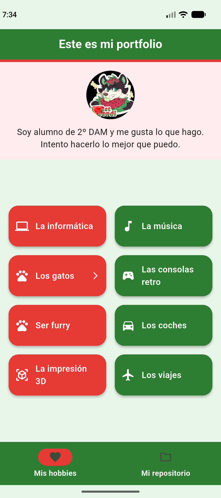
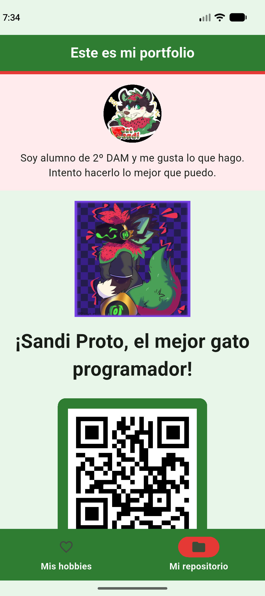
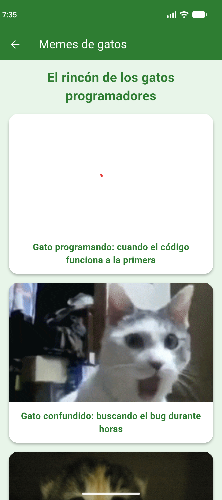

# Mi portfolio Flutter

Aplicación móvil desarrollada con Flutter para presentar mi perfil, mis aficiones y un enlace a mi repositorio de GitHub. El diseño utiliza una paleta inspirada en una sandía, con navegación inferior y soporte para orientación vertical y horizontal.

## Capturas

### Mis hobbies

La pantalla principal muestra el perfil y una cuadrícula de aficiones. La tarjeta de gatos abre una sección interactiva con memes.



### Mi repositorio

Incluye una ilustración de Sandi Proto y un código QR que enlaza al perfil de GitHub.



### Memes de gatos

Sección accesible desde la tarjeta **Los gatos**, con contenido remoto y navegación de vuelta a la pantalla principal.



## Funcionalidades

- Perfil personal con avatar y descripción.
- Cuadrícula responsive con ocho aficiones.
- Navegación inferior entre **Mis hobbies** y **Mi repositorio**.
- Sección de memes de gatos con imágenes remotas.
- Código QR hacia [`github.com/Catsandi06`](https://github.com/Catsandi06/).
- Adaptación a diferentes tamaños de pantalla y orientación.
- Interfaz Material 3 con animación al cambiar de sección.

## Tecnologías

- [Flutter](https://flutter.dev/)
- Dart
- Material 3
- [`qr_flutter`](https://pub.dev/packages/qr_flutter) para generar el código QR

## Requisitos

- Flutter SDK compatible con Dart `^3.13.1`
- Android Studio, Chrome o un dispositivo compatible con Flutter
- Conexión a Internet para cargar el avatar de GitHub y los memes

## Instalación y ejecución

```bash
git clone https://github.com/Catsandi06/good-portfolio.git
cd good-portfolio
flutter pub get
flutter run
```

Para ejecutarlo en Chrome:

```bash
flutter run -d chrome
```

## Estructura principal

```text
lib/
  main.dart                  # Aplicación y widgets de las distintas pantallas
assets/
  images/Sandi_proto.jpg     # Imagen usada en la vista del repositorio
docs/
  screenshots/               # Capturas incluidas en esta documentación
```

## Autor

Portfolio de **Catsandi06**, alumno de 2º de Desarrollo de Aplicaciones Multiplataforma.
